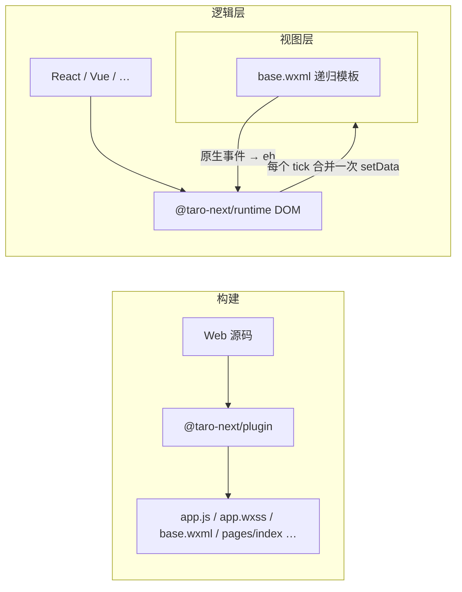

# taro-next

把普通的 Web 前端代码打包成微信小程序。应用照常调用 `document.createElement`、`appendChild`、`addEventListener`，用 React、Preact、Vue、Svelte、Solid 等框架渲染到 `document.body`；构建插件把产物整理成小程序目录，运行时在逻辑层模拟 DOM/BOM，再通过 `setData` 把 DOM 树交给通用 WXML 模板渲染。

不需要框架适配层，也不用写 WXML。

## 包

| 包 | 说明 |
| --- | --- |
| [`@taro-next/plugin`](packages/plugin) | 构建插件（基于 unplugin），支持 Vite、Rolldown、Rollup、webpack、Rspack、Rsbuild、esbuild、Bun、Farm |
| [`@taro-next/runtime`](packages/runtime) | 小程序逻辑层里的 DOM/BOM 实现，以及 DOM 与视图层之间的数据和事件桥接 |

## 工作原理



- 插件把用户入口包进一个虚拟入口，由它注册 `App()`。所有 JS 打进单个 `app.js`（包括 `import()`），CSS 合并成 `app.wxss`。
- 打包时，代码里对 `window`、`document`、`location`、`Event`、`MutationObserver` 等全局变量的自由引用会被替换为从 `@taro-next/runtime` 导入。
- 小程序只有一个页面 `pages/index/index`，它渲染 `document.body`。路由交给前端路由库，运行时提供内存版的 `history` / `location`。
- DOM 变更按数据路径（如 `root.cn[0].cn[2].v`）增量发送，每个 tick 对每个页面或组件最多调用一次 `setData`。
- `base.wxml` 只为源码中出现过的原生组件生成模板。嵌套超过 `baseLevel` 层后，改由递归自定义组件 `comp` 继续渲染。
- HTML 标签渲染为带 `h5-<tag>` 类名的 `view`，`img` 渲染为 `image`；`<scroll-view>`、`<video>` 等原生组件可以直接当作元素使用。

## 快速开始

```sh
pnpm add @taro-next/runtime
pnpm add -D @taro-next/plugin
```

```ts
// vite.config.ts
import taro from "@taro-next/plugin/vite";
import { defineConfig } from "vite";

export default defineConfig({
  plugins: [taro({ appConfig: { window: { navigationBarTitleText: "Demo" } } })],
});
```

```tsx
// src/index.tsx：默认入口，顶层直接渲染到 document.body
import { createRoot } from "react-dom/client";

createRoot(document.body).render(<h1>Hello</h1>);
```

执行 `vite build`，再用微信开发者工具打开输出目录（默认 `dist`）。其他打包器的用法和全部选项见 [`packages/plugin`](packages/plugin)。

## 示例

[`examples/`](examples) 下有 `react`、`preact`、`vue`、`svelte`、`solid` 五个示例，都用 Vite 构建，内容相同：计数器、待办列表、`scroll-view`，以及一个超过 `baseLevel` 的深层嵌套组件。

```sh
pnpm install
pnpm -C examples/react build   # 输出到 examples/react/dist
pnpm -C examples/react dev     # vp build --watch --mode development
```

## 开发

仓库使用 pnpm workspace 和 [Vite+](https://viteplus.dev)（`vp`），TypeScript 版本为 7.1 beta。

```sh
pnpm install
pnpm -C packages/runtime exec vp pack   # 先构建 runtime，plugin 和示例都依赖它的 dist
pnpm -C packages/plugin exec vp pack
pnpm -C packages/runtime test
pnpm -C packages/plugin test            # 用每种打包器构建 fixture，并模拟小程序环境执行产物；装了 bun 才会跑 Bun 用例
pnpm -C packages/plugin schema          # 由 src/schema/*.schema.json 重新生成配置类型
```

## 限制

- 只支持微信小程序，只有一个页面。
- 不支持自定义元素（`customElements` 为 `undefined`）。
- `getComputedStyle` 只返回内联样式。
- `innerHTML` 解析器只处理框架生成的规范标记，不实现 HTML5 的容错规则。
- CSS 选择器引擎只实现了常用子集，详见 [`packages/runtime`](packages/runtime)。
